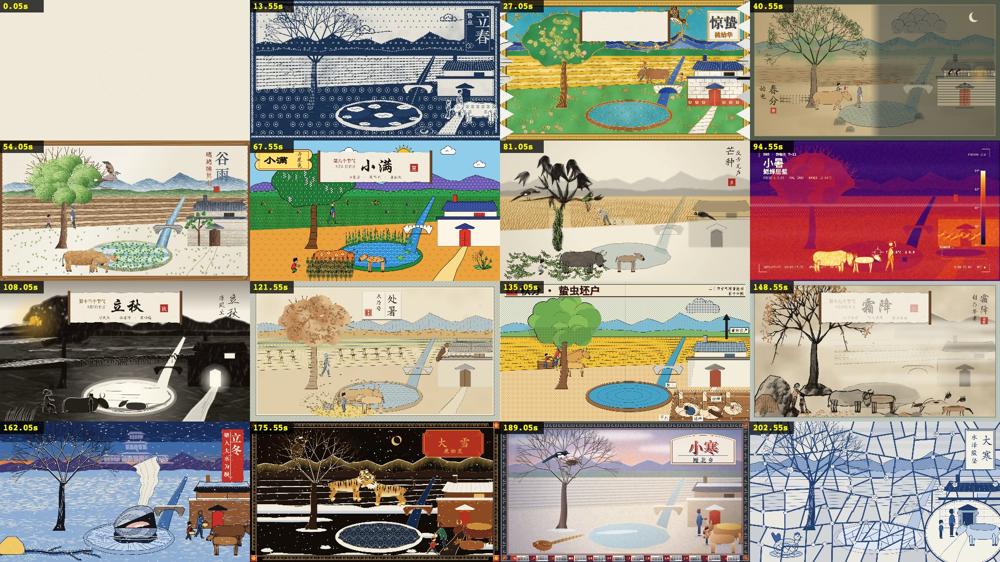

# multistyles-motion-creator

一个 Claude Code skill，用来做「一段一种画风」的串联长片：画面用 HTML Canvas 逐帧画，在 headless Chrome 里按时间渲染，导出 2K60 的 MP4，另出循环版和 9:16、1:1 的平台版。配乐的音符由代码写，音色可以用 Tone.js 合成，也可以用真实乐器采样渲染。

它整理自两支已经做完的片子：

- **《八十一难》**：《西游记》九九八十一难，一难一种画风，按艺术史从四万年前排到 2026 年，师徒四人走过 81 个画框，7 分 47 秒。
- **《二十四节气》**：同一个黄河流域的村口过一年，一个节气一种画风（21 种中国画风加热成像、长曝光、X 光），农妇、娃和耕牛按农时干活，清明生下的小牛犊到大寒长大，3 分 36 秒。配乐按《礼记·月令》给四季配宫商角徵羽，用二胡、笛子、箫和筝的真实采样演奏。

两支片子的代码都由 Claude Code（Opus 5.5）主线和几支子代理队伍写成，作者负责选题、定标准和看片验收。下面两张是成片的接触表。




## 里面有什么

- `SKILL.md`：入口，写了用户的验收口径、流程、硬规则和资源索引。
- `references/`：选题和总表、引擎接口、单元制作标准、分队并行、配乐（两课）、审片与交付、踩过的坑、Art Lock、故事轨，以及两次案例复盘和一份错误分析（每个问题是谁发现的、为什么会出、现在怎么防）。
- `templates/`：派给子代理的各类简报（画风样图、单元扩展、故事接入、采样调研、配乐渲染、粗看审片），总表行格式，lead sheet 骨架。
- `scripts/`：新建工程、全片帧差扫描、扒 X 帖子和视频、带时间码的接触表、配乐结构测量、帧差、节拍点、拼图、字体探测，以及采样配乐用的 Faust 混响。
- `assets/example-xiyou-81nan/`：《八十一难》的全部源码，画廊墙骨架，带角色骨骼。
- `assets/example-jieqi-24/`：《二十四节气》的全部源码，固定构图骨架，带故事轨、现象过渡、标题卡、日晷片头和 Art Lock 页。

仓库里没有成片视频、渲染出来的配乐和采样。成片用示例工程自己导出（2K60 全片在作者的 M5 Pro 上约 1.5 到 4 分钟）；采样按 `assets/example-jieqi-24/refs/samples-cn-REPORT.md` 自己下载，授权都核实过。

## 安装

```sh
git clone https://github.com/zzzhhn/multistyles-motion-creator ~/.claude/skills/multistyles-motion-creator
```

Claude Code 会根据 `SKILL.md` 的描述自动触发，比如「做一支 N 种画风的串联视频」「艺术史速通」「一格一画风」「二十四节气」；也可以直接点名调用。

## 依赖

- Node.js（作者用的是 22）和系统里装的 Google Chrome。导出靠 Chrome 的 WebCodecs 编 H.264，一般的 Chromium 构建没有这个编码器。
- `playwright-core`：`npm i playwright-core`，或者设环境变量 `PLAYWRIGHT_CORE` 指向已有的安装。`tools/pw.cjs` 会按顺序去找。
- ffmpeg：接触表、换音轨、压缩、测响度都要用。
- Python 3 和 numpy：分析脚本要用。
- 只有采样配乐需要：一个放采样和工具的目录（环境变量 `AUDIO_TOOLS`），里面是 VSCO-2 CE、各民乐采样库、装了 numpy、soundfile、librosa、pysfizz 的 Python 虚拟环境，和 `scripts/audio-tools/node/`（`npm install`）。

目前只在 macOS 上跑过。示例里的画风用了不少 macOS 自带的中文字体，别的系统会回退到默认字体，可以先用 `scripts/fontprobe.cjs` 看看哪些字体可用。

## 试跑示例

```sh
cd assets/example-jieqi-24
node tools/storycheck.cjs                               # 故事轨连续性
node tools/shot.cjs all                                 # 24 个画风的记忆点帧和总览
node tools/export.cjs artlock/film.html /tmp/jieqi.mp4  # 全片（没有采样时没有声音）

cd ../example-xiyou-81nan
node tools/still.cjs src/film.html /tmp/x 3,120,460 0.5
node tools/build.cjs /tmp/xiyou.html film.html && node tools/export.cjs /tmp/xiyou.html /tmp/xiyou.mp4
```

开新项目：`scripts/new_project.sh <目录> jieqi`（固定构图）或 `scripts/new_project.sh <目录> xiyou`（画廊墙）。

## 代价最大的几条经验

- 每一帧只由时间 t 决定，这样才能逐帧导出，任何一帧也能单独重渲染来查问题。
- 讲故事的单元要 5 到 8 秒。《八十一难》第一版每格 2.5 秒，被评看不清。
- 只借画风的视觉语言，不借它原有的题材；主题有文化归属时先用这个文化自己的画风。《二十四节气》第一版的日式画风被评「和主题的关联性有点弱」。
- 换画风的长片要有故事感：让主体的状态只由全片时间决定，换画风时它在原地，身上有变化（衣服、农具、长大的小牛），过渡由下一个节气的自然现象带进来。第一版的人和牛只是各画风自己摆的装饰，被评「故事感不强」。
- 配乐要有自己的曲式，每段要能凭耳朵分出来。一个旋律换乐器重复、每格重写和声、全片一组五声音阶只换独奏乐器，都被否掉过；有文化身份的独奏乐器要用真实采样，代码合成的笛子和二胡被评「乐器音色不够 authentic & identical」。
- 画风先看图再拍板（Art Lock 页），新版出来后只派一个代理粗看，再加一遍全片帧差扫描；结构上的问题靠开工前的清单，粗看抓不到。

## English

A Claude Code skill for making one continuous film out of many short units, each in a different art style, with every frame and the score written in code (HTML Canvas, headless Chrome, WebCodecs, 2K60 MP4; music synthesised with Tone.js or rendered from real instrument samples). It was distilled from two finished films: the 81 tribulations of *Journey to the West* (7:47, 81 styles, a gallery wall), and the 24 solar terms of one Chinese village (3:36, 24 styles, a farm family living through the year, with a modal score on erhu, dizi, xiao and zither samples). Both projects ship as runnable examples. The docs are in Chinese; code comments and the music renderer briefs are in English.

## 致谢与许可

方法和灵感来自：

- EianLu 的 Opus 5.5 动效视频 8 步指南：https://x.com/eianlu/status/2104758915636593119
- GoSailGlobal 整理的 Claude 视频 skill 榜单：https://x.com/gosailglobal/status/2104215886429331580
- 花叔的 huashu-art-motion：https://x.com/alchainhust/status/2107347834668224687 ， https://github.com/alchaincyf/huashu-art-motion
- 作曲方法参考了 https://github.com/jtydhr88/music-composition-skills

《西游记》原文、《月令七十二候集解》和《礼记·月令》都属于公有领域。

本仓库以 MIT 许可发布，见 `LICENSE`。打包进来的 Tone.js、构建时用到的第三方组件、采样库的授权见 `THIRD_PARTY_NOTICES.md`。
