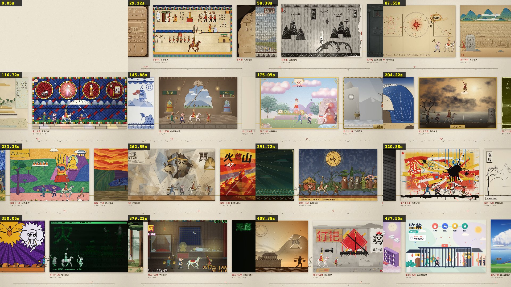

# multistyles-motion-creator

一个 Claude Code skill，用来做「一段一种画风」的串联长片：画面用 HTML Canvas 逐帧画，配乐用 Tone.js 合成，在 headless Chrome 里按时间渲染，导出 2K60 的 MP4，另出 9:16 和 1:1 的平台版。

它整理自一支已经做完的片子《八十一难》。《西游记》九九八十一难，一难一种画风，按艺术史从四万年前排到 2026 年，师徒四人走过 81 个画框，全片 7 分 47 秒，2560×1440@60。代码由 Claude Code（Opus 5.5）主线和九支子代理队伍写成，作者负责选题、定标准和看片验收。下图是成片的接触表，大约每 29 秒取一帧。



## 里面有什么

- `SKILL.md`：入口，写了验收口径、10 步流程、硬规则和资源索引。
- `references/`：九篇文档，依次是参考调研、单元总表、引擎接口、单元制作标准、分队并行、配乐、审片与交付、踩过的坑，以及《八十一难》的案例复盘。
- `templates/`：队伍简报、粗看审片简报、配乐渲染简报、总表行格式，还有一份带格式检查的 lead sheet 骨架。
- `scripts/`：扒 X 帖子和视频、出带时间码的接触表、新建工程、测量配乐结构（响度弧、调性区域、重复度），以及帧差、节拍点、拼图、字体探测。
- `assets/example-xiyou-81nan/`：《八十一难》定稿的全部源码，可以直接跑。包括引擎、81 个画风文件、乐谱和渲染器、导出工具、九支队伍的制作日志和审片报告。

成片视频不在仓库里。需要的话用示例工程自己导出，2K60 全片在作者的 M5 Pro 上约 4 分钟，文件约 1.8 GB。

## 安装

```sh
git clone https://github.com/zzzhhn/multistyles-motion-creator ~/.claude/skills/multistyles-motion-creator
```

Claude Code 会根据 `SKILL.md` 的描述自动触发，比如「做一支 N 种画风的串联视频」「艺术史速通」「一格一画风」；也可以直接点名调用。

## 依赖

- Node.js（作者用的是 22）和系统里装的 Google Chrome。导出靠 Chrome 的 WebCodecs 编 H.264，一般的 Chromium 构建没有这个编码器。
- `playwright-core`：`npm i playwright-core`，或者设环境变量 `PLAYWRIGHT_CORE` 指向已有的安装。`tools/pw.cjs` 会按这个顺序去找，再找全局的 `@playwright/cli`。
- ffmpeg：出接触表、换音轨、压缩平台版、检查响度都要用。
- Python 3 和 numpy：分析脚本要用。

目前只在 macOS 上跑过。示例里的画风用了不少 macOS 自带的中文字体（宋体、楷体、行楷等），别的系统会回退到默认字体，可以先用 `scripts/fontprobe.cjs` 看看哪些字体可用。

## 试跑示例

```sh
cd assets/example-xiyou-81nan
node tools/still.cjs src/film.html /tmp/x 3,120,460 0.5     # 开场、中段、片尾三张静帧
node tools/cellsheet.cjs 29 /tmp/c29 --detail                # 第 29 难的 8 帧拼图和 2K 单帧
node tools/build.cjs /tmp/xiyou.html film.html && node tools/export.cjs /tmp/xiyou.html /tmp/xiyou.mp4   # 全片
```

开新项目用 `scripts/new_project.sh <目录>`，它会把示例复制过去。之后照 `references/03-engine.md` 最后一节，换掉单元数据、角色和片头片尾。

## 代价最大的几条经验

- 每一帧只由时间 t 决定。这样才能逐帧导出，任何一帧也都能单独重渲染来查问题。
- 讲故事的单元要 5 到 6 秒。第一版每格 2.5 秒，被评太短，看不清。
- 只借画风的视觉语言，不借它原有的题材。古埃及画风没问题，画面里出现古埃及神明就出戏了。
- 配乐要有独立于画面切分的曲式。前两版一个是同一个动机换乐器重复 81 次，一个是每格重写和声，都被否掉；第三版由主线手写 175 小节的 lead sheet，子代理只管渲染，这才通过。
- 新版出来后最多派一个代理粗看，主要还是靠人看成片。

## English

A Claude Code skill for making one continuous film out of many short units, each in a different art style, with every frame and the score generated by code (HTML Canvas, Tone.js, headless Chrome, WebCodecs, 2K60 MP4). It was distilled from a finished 7:47 film of the 81 tribulations in *Journey to the West*, one art style per tribulation, and ships that project as a runnable example under `assets/example-xiyou-81nan/`. The docs are in Chinese; code comments and the music renderer brief are in English.

## 致谢与许可

方法和灵感来自：

- EianLu 的 Opus 5.5 动效视频 8 步指南：https://x.com/eianlu/status/2104758915636593119
- GoSailGlobal 整理的 Claude 视频 skill 榜单：https://x.com/gosailglobal/status/2104215886429331580
- 花叔的 huashu-art-motion：https://x.com/alchainhust/status/2107347834668224687 ， https://github.com/alchaincyf/huashu-art-motion
- 作曲方法参考了 https://github.com/jtydhr88/music-composition-skills

《西游记》原文属于公有领域，难簿取自维基文库第九十九回。

本仓库以 MIT 许可发布，见 `LICENSE`。打包进来的 Tone.js 和参考过的开源项目见 `THIRD_PARTY_NOTICES.md`。
